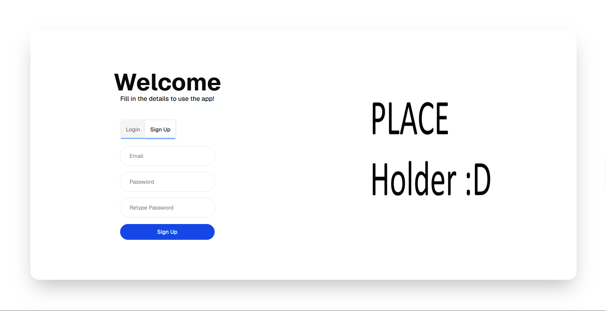
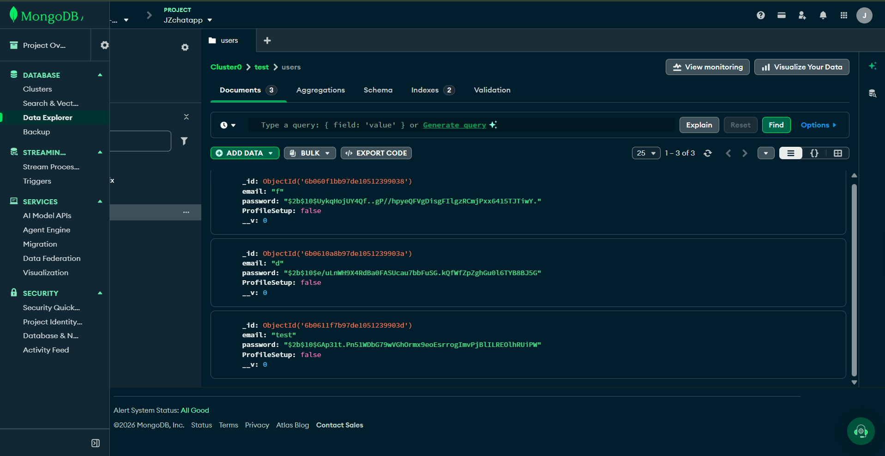

# JZChatAPP
A chatapp that allows you make an account and chat with other people!
this is for hackclub
demo link: https://jzchatapp.onrender.com/auth
current features: make your account and store in the mongodb atlas database!
(srry only this feature yet)


## how to set it up?
### Prerequisistes
* **node.js** ()
* **MongoDB** (local or MongoDB Atlas)

### 1. Clone the Repository
```bash
git clone [https://github.com/jessezhang688-jpg/JZChatApp.git](https://github.com/jessezhang688-jpg/JZChatApp.git)
cd JZChatApp
```

## 2. Configure the server
### Navigate to the server directory and install dependencies:
```bash
cd server
npm install
```

### Create a .env file inside the server folder with the following environment variables:
```bash
PORT=3001
DATABASE_URL=your_mongodb_connection_string
ORIGIN=http://localhost:5173
JWT_KEY=your_jwt_secret_key
```

### Start the server:
```bash
node index.js
```

## 3. Configure frontend client
### open a new terminal window, and navigate to client directory and install dependencies:
```bash
cd client
npm install
```

### Start Vite dev server:
```bash
npm run dev
```
## Deploy (Render)
### 1.Create a new webservice and connect your github directory

### 2. Configure the following:
    Root directory: Leave blank
    Build command: npm run build
    Start command: npm start

### 3. Add your enviornment variables: 
    DATABASE_URL
    JWT_KEY
    ORIGIN (set to your live Render url. ex: yourproject.onrender.com)
### click Deploy Lattest commit. Render will automaticly build the front end onto the url