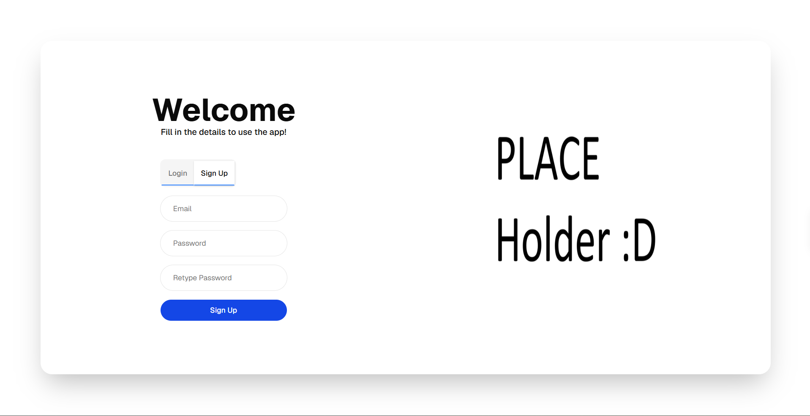
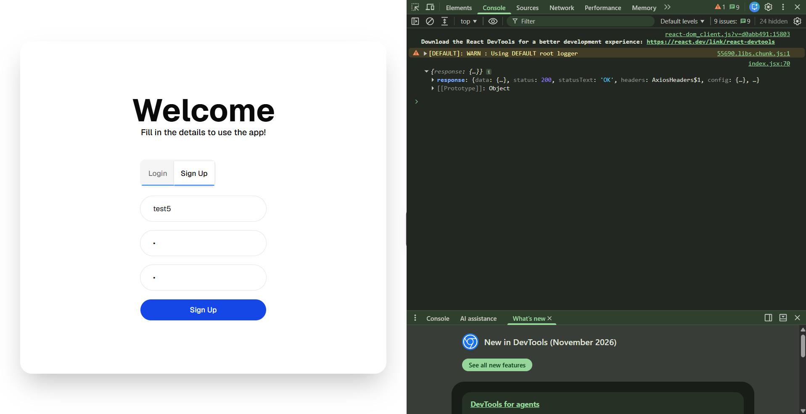
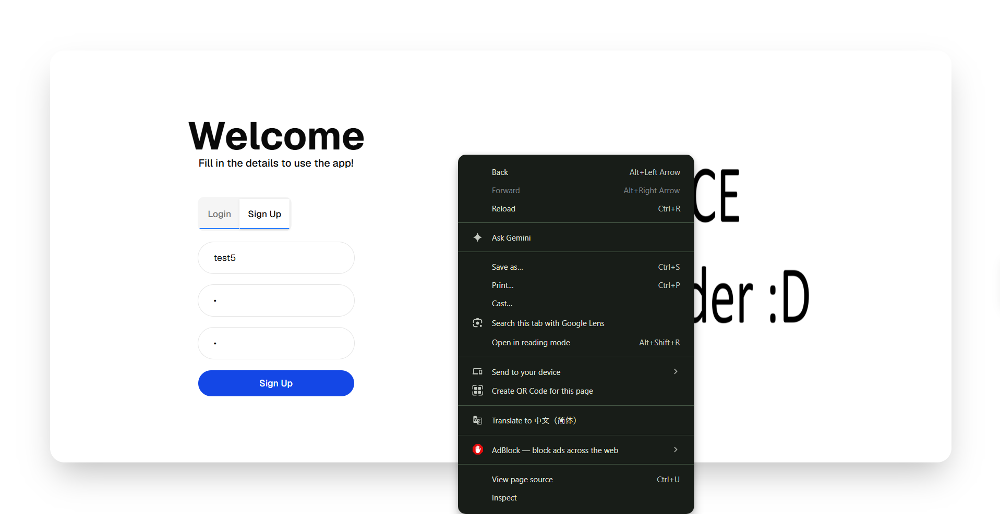
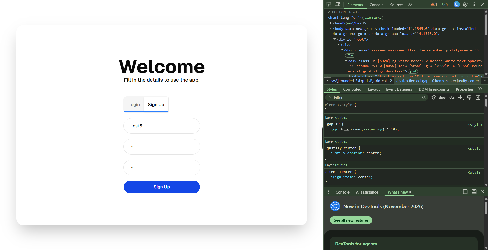
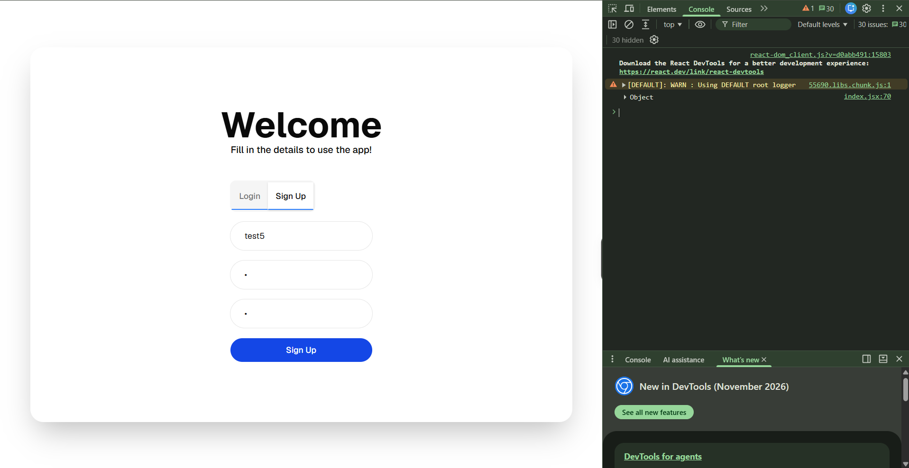
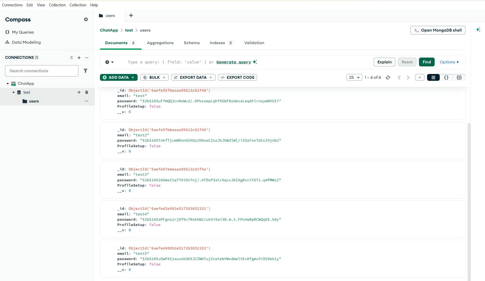

A chatapp that allows you make an account and chat with other people!
this is for hackclub
demo link: https://require-jigsaw-gravel.ngrok-free.dev/auth
current features: make your account and store in the mongodb database!
(srry only this feature yet)

you can check if your account is made or not by checking the console menu
how to open it: 
1. right click on your browser window

2. click "inspect"

3. click "console"

then you can see your account is made!

also, if you want me to further prove it, dm me on slack(@jessezhang688) i can send a screenshot of my mongodb compass
is it safe? ofc! I'll delete all users when the app is fully done!
